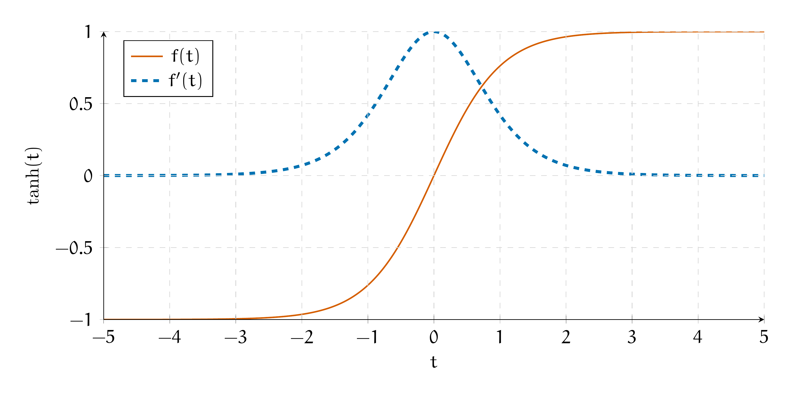

# 4. Гиперболический тангенс

Функция $f(t) = \tanh(t) = \frac{2}{1 + e^{-2t}} - 1$ называется гиперболическим тангенсом.


__а)__ Что происходит при $t \to +\infty$? А при $t \to -\infty$?

```{dropdown} Решение


Мы знаем, что при $t \to +\infty$ функция $e^{-2t} \to 0$, значит $f(t) \to 1.$ 

По аналогии при $t \to -\infty$ функция $e^{-2t} \to \infty$, значит $f(t) \to -1.$ 

```

__б)__ Как связаны между собой $f(t)$ и $f'(t)$? Как они выглядят на графике? 

```{dropdown} Решение
Если взять производную сложной функции, можно получить, что 

$$
f'(t) = 1 - f(t)^2.
$$

Изобразим функцию активации и её производную на графике 



```

__в)__ Выпишите формулы для forward pass и backward pass через слой с тангенсом. 

```{dropdown} Решение
Мы уже нашли выше производную. У гиперболического тангенса нет обучаемых параметров, получается, прямой проход через него делается по формуле

$$
o = f(h).
$$

Обратный шаг делается по формуле

$$
d = (1 - f(h)^2) \cdot d.
$$

То же самое можно записать как 

$$
\frac{\partial L}{\partial h} = (1 - f(h)^2) \cdot \frac{\partial L}{\partial o}.
$$

```

__г)__ Правда ли, что тангенс способствует затуханию градиента и параличу нейронной сети? Какое максимальное значение принимает производная тангенса? 

```{dropdown} Решение
Да, правда. Производная $1 - f(t)^2$ лежит между $0$ и $1$, и на краях она близка к нулю, как и у сигмоиды.

Максимальное значение производной тангенса равно $1$, оно достигается при $t = 0$. Это вчетверо больше, чем $0.25$ у сигмоиды, поэтому через тангенс градиент затухает заметно слабее.
```

__д)__ Как у тангенса дела с центрированием относительно нуля? 

```{dropdown} Решение
В отличие от сигмоиды, тангенс центрирован относительно нуля. Это его второй плюс. В остальном, это плохая функция активации, способствующая затуханию градиента.
```

__е)__ Сигмоиду обычно используют для того, чтобы на последнем слое получать вероятности. Либо в местах, где внутри нейросети нужно отщипнуть долю от какого-нибудь числа (например, в LSTM). Как думаете, где на практике используют тангенс? 

```{dropdown} Решение
Тангенс не используют в качестве функции активации скрытых слоёв в глубоких полносвязных и свёрточных сетях из-за тех же самых недостатков, что и сигмоиду. Зато в рекуррентных сетях (RNN, LSTM, GRU) это штатная функция активации. Ещё его используют, когда на выходе из слоя нужно получить число с отрезка $[-1; 1]$.

Например, когда работают с картинками, их нормируют на отрезок $[-1; 1].$ Если мы захотим обучить нейросетку, которая генерирует картинки, на выходе нам надо будет получать числа с этого отрезка. Тут нам и пригодится тангенс. 
```
