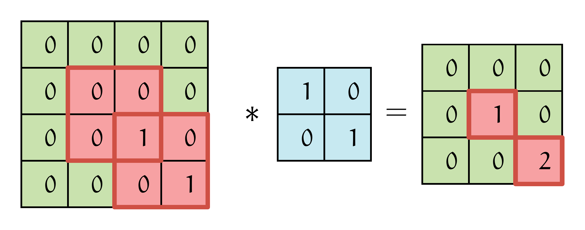
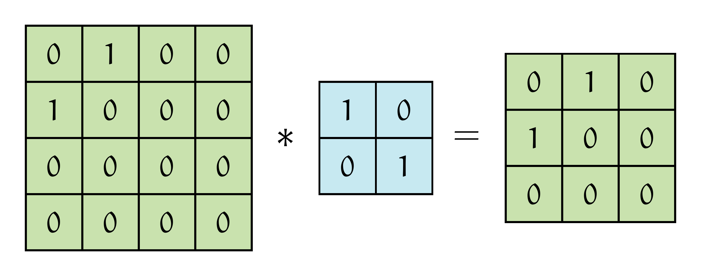
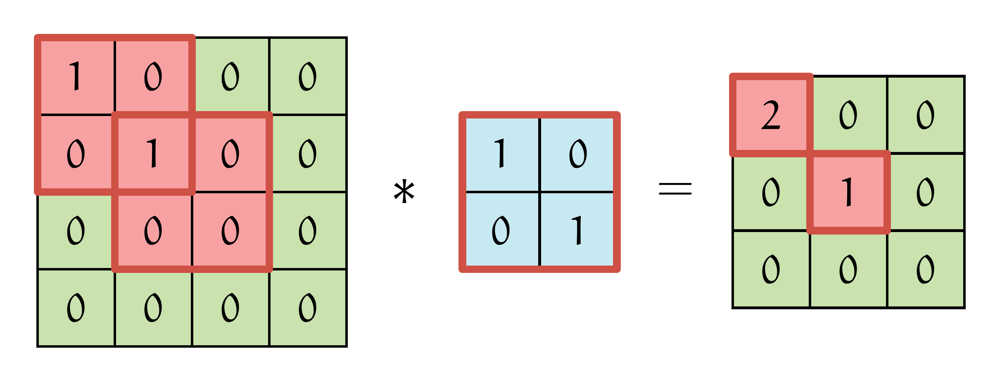

# 2. Классификатор слэшей

У Маши есть куча картинок размера $4 \times 4,$ на которых нарисованы прямые и обратные слэши. 

```{figure} ../images/problem_set_06/img02_slash_01.png
---
width: 350px
name: conv-slashes
---
```

Маша хочет классифицировать все картинки на два класса. Помогите ей придумать для этого алгоритм, который будет состоять из свёртки и пулинга. 


```{dropdown} Решение
Нужно придумать свёртку так, чтобы она находила либо прямые, либо обратные слэши. В примере ниже мы применили свёртку к исходной картинке и получили новую картинку. В ней записана информация о том, что именно свёртка разглядела на исходной картинке. Результат применения свёртки -- это составные признаки, полученные из исходной картинки (feature map).  



Попробуем применить эту же свёртку к прямому слэшу. 



Видно, что для обратного слэша в результате применения свёртки есть число $2$. Для прямого слэша максимальное число -- это единица. Попробуем передвинуть обратный слэш в какое-нибудь другое место и посмотрим, что получится после применения свёртки. 



Снова самое большое число -- это двойка. Получается следующий алгоритм: 

1. Применяем к картинке ядро в виде обратного слэша.
2. Находим на получившейся картинке максимальное число.
3. Если это двойка, у нас обратный слэш, если единица, у нас прямой слэш.

Такой алгоритм будет работать независимо от того, где именно находится наш слэш. Сравните первую и третью картинки решения: слэш переехал из правого нижнего угла в левый верхний, и двойка на карте признаков переехала вместе с ним. Получается, что свёртка не инвариантна, а эквивариантна к местоположению объекта на картинке: сдвинули объект -- сдвинулся и ответ свёртки. А вот максимуму всё равно, в какой клетке стоит двойка. Поэтому весь алгоритм «свёртка + максимум» инвариантен к положению слэша. Каждая свёртка пытается искать на изображении какой-то конкретный образ. Если на изображении, полученном после применения свёртки, у нас есть большие числа, они сигнализируют о том, что свёртка нашла то, что искала. 

Обратите внимание, что наша свёртка видит только квадрат размера $2 \times 2$. Если бы наши слэши были длиной в три пикселя, она бы по-прежнему отличала прямые слэши от обратных. Но длинный обратный слэш она не смогла бы отличить от короткого: в обоих случаях максимум равен двойке. Зато две применённые по очереди свёртки спокойно бы справились с такой задачей: для длинного слэша они выдадут $4$, а для короткого не больше $3$. 

Вторая свёртка применяется к уже свёрнутому изображению. В каждой его клетке записано число, которое посчитано по квадрату $2 \times 2$ исходной картинки. Вторая свёртка смотрит на квадрат $2 \times 2$ из таких клеток. Получается, что вторая свёртка косвенно, через первую свёртку, будет понимать, что находится в квадрате размера $3 \times 3$. 

Область, которую разглядели наши свёртки, называют **полем обзора (receptive field).** В одной из следующих задач мы узнаем, что, если просто применять свёртки друг за другом, мы будем растить поле обзора слишком долго. Чтобы это происходило быстрее, обычно используют пулинг.  

```

