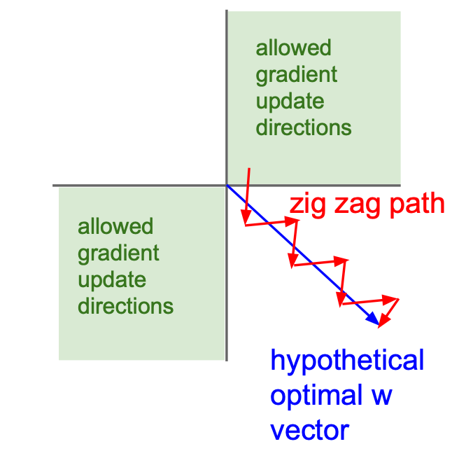

# 10. Порядок слоёв

У Маши есть три друга: Алекс, Илья и Джеффри. Они обучают свёрточные сети. Объясните, чей подход правильный и почему. 

- Алекс использует свёртку $3 \times 3$ с $ReLU,$ а затем использует max-pooling. 
- Илья использует свёртку $3 \times 3$, затем делает max-pooling, а после применяет $ReLU.$
- Джеффри делает свёртку $3 \times 3$, а после max-pooling без функции активации. 


```{dropdown} Решение
Результаты работы слоя Ильи и слоя Алекса будут одинаковые. Если мы поменяем местами ReLU и max-pooling, результат от этого не изменится.

Однако в случае Алекса мы сделаем дофига лишних расчётов. Мы посчитаем ReLU от ячеек, которые пулинг удалит. Не очень понятно, зачем нам это нужно. Ячейка Ильи более экономна. 

Джеффри, в своей ячейке, решил проигнорировать нелинейность в виде ReLU. Если Max-pooling выплюнет положительное число, ReLU ничего не сделает и не внесёт никакой дополнительной нелинейности в работу пулинга. 

Если все выходы свёртки положительны, ReLU абсолютно бесполезна. Но у свёртки бывают отрицательные веса, поэтому её выход может оказаться отрицательным, даже если на вход пришли только положительные пиксели. Если предыдущие свёртки создали нам отрицательные пиксели, ReLU их занулит и внесёт дополнительную нелинейность в нашу архитектуру. 

Обычно пиксели картинки, которую подают на вход в нейросеть, нормируют на отрезок $[-1, 1]$. В такой ситуации нелинейность в виде ReLU чаще срабатывает и архитектура становится более выразительной. Однако причина такой нормировки заключается в другом. 

Если на вход в слой сетки пойдут только положительные числа, тогда градиенты по параметрам этого слоя будут иметь один и тот же знак. Движение по ним будет идти в одну и ту же сторону. Строго это верно для одного нейрона и одного наблюдения: $\frac{\partial L}{\partial w_i} = \delta \cdot x_i$, где $\delta$ --- производная потерь по выходу нейрона, и при $x_i > 0$ знак у всех производных такой же, как у $\delta$. В свёртке производная по весу складывается из слагаемых вида $\delta_p \cdot x$ по всем положениям ядра $p$ (вспомните задачу про свёрточный и полносвязный слой), у разных $\delta_p$ бывают разные знаки, и знаки у производных по разным весам могут различаться. То же происходит при усреднении по батчу. Эффект от этого слабее, но не исчезает.

Пусть у нас есть два параметра. По одному надо двигаться в положительную сторону, а по второму в отрицательную (голубая стрелка). Наши градиенты никогда не будут оказываться разных знаков. Они оба всегда будут либо положительными, либо отрицательными. Из-за этого движение будет идти зигзагами. В точку оптимума мы будем идти дольше. 



Чтобы избежать этого и получать в слой входы разных знаков, нам нужна нормировка пикселей на отрезок $[-1, 1]$. Таким образом мы ускоряем сходимость обучения нашей сетки. С аналогичной проблемой мы сталкивались в листочке про функции активации. Нам хотелось, чтобы они были центрированы относительно нуля.

Картинка взята из курса [cs231n.](http://cs231n.stanford.edu/index.html)

```


