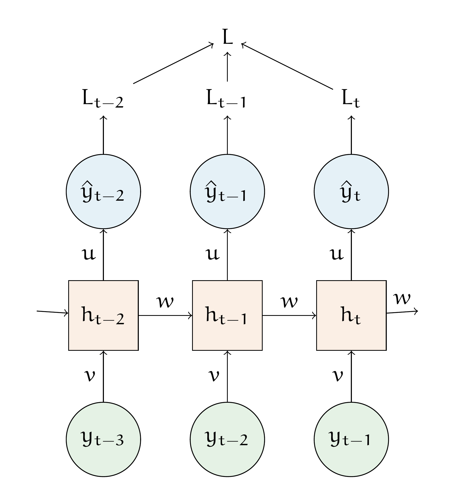
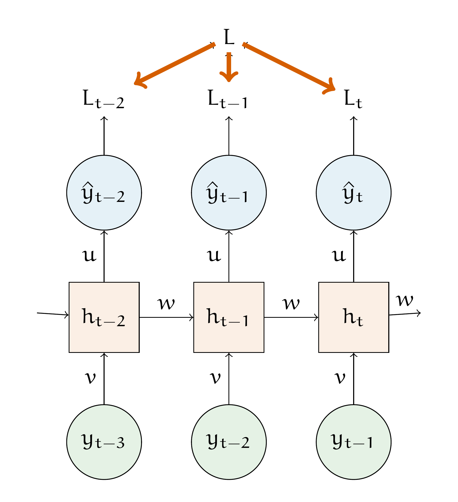
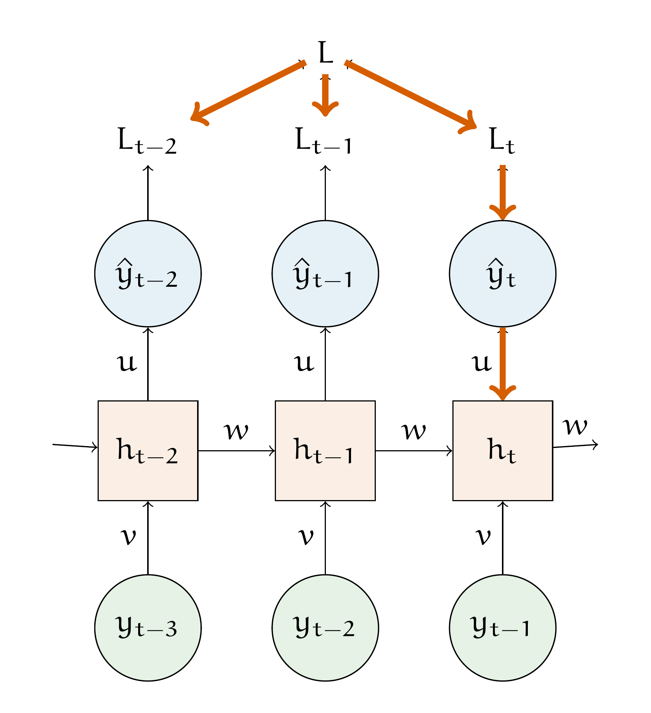
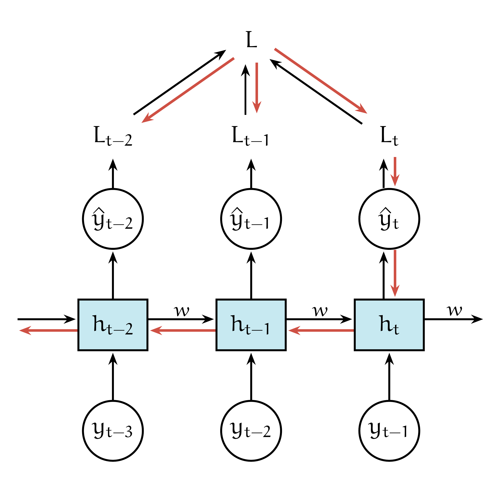

# 2. Туда и обратно 

Маша хочет сделать шаг обратного распространения ошибки через рекуррентную ячейку для последовательности $y_0 = 0, y_1=1, y_2 = -1, y_3 =2$. Скрытое состояние инициализировано как $h_0 = 0$. Все веса инициализированы как $0.5$. Во всех уравнениях, описывающих ячейку, нет констант. В качестве функций активации Маша использует $ReLU$. В качестве функции потерь Маша использует сумму квадратов ошибок $L = \sum_{t=1}^{3} (y_t - \hat y_t)^2$. Скорость обучения $\eta = 0.1$. 


```{figure} ../images/problem_set_07/img02_rnn.png
---
width: 25%
name: rnn-neuron-numbers
---
```

__а)__ Сделайте прямой шаг через ячейку. Для каждого элемента последовательности постройте прогноз. Посчитайте значение ошибки. 


```{dropdown} Решение

Рекуррентную сеть можно рассматривать как несколько копий одной и той же сети, каждая из которых передаёт информацию последующей копии. Веса для всех копий одинаковые. 



Когда мы строим прогнозы, мы движемся слева направо и снизу вверх. Чтобы сделать прямой шаг, нам нужно подставить соответствующие значения в формулы пересчёта

\begin{equation*} 
	\begin{aligned}
		h_t =& Relu(0.5 \cdot h_{t-1} + 0.5 \cdot y_{t-1})\\
		\hat{y_t} =& Relu(0.5 \cdot h_t).
	\end{aligned}
\end{equation*} 

Тогда мы получим 

|  $t$       |    $0$    |    $1$    |    $2$    |    $3$    |
|:----------:|:---------:|:---------:|:---------:|:---------:|
|  $h_t$     |    $0$    |    $0$    |    $0.5$  |    $0$    |
| $\hat y_t$ |     -     |    $0$    | $0.25$    |    $0$    |
|  $y_t$     |    $0$    |    $1$    |    $-1$   |    $2$    |
|  $L_t$     |     -     |    $1$    |  $1.5625$ |    $4$    |

Получаем итоговое значение ошибки нашего нейрона на всей последовательности

$$
L = L_1 + L_2 + L_3 = 1 + 1.5625 + 4 = 6.5625.
$$

Именно его нам надо будет уменьшать в ходе обратного распространения ошибки. 

```

__б)__ Выпишите для рекуррентного нейрона производные функции ошибки по весам $u,v,w$. 


```{dropdown} Решение
**Выведем формулы для шага по весам $u$.** Нам нужно найти производную $\frac{\partial L}{\partial u}$. Итоговая ошибка ищется как сумма ошибок на каждом элементе последовательности. 



Это означает, что наша производная разваливается в сумму производных

$$
\frac{\partial L}{\partial u} = \sum_{t=1}^T \frac{\partial L_t}{\partial u}.
$$

Посмотрим на одно слагаемое. 



Для него производную можно расписать через предыдущие элементы нашего графа вычислений

$$
\frac{\partial L_t}{\partial u} = \frac{\partial L_t}{\partial \hat{y}_t} \cdot \frac{\partial \hat{y}_t}{\partial u}.
$$

Все эти производные можно найти, если вспомнить формулы рекуррентного нейрона

\begin{equation*} 
	\begin{aligned}
		h_t =& f_h(b_h +w \cdot h_{t-1} + v \cdot y_{t-1})\\
		\hat{y}_t =& f_y(b_y + {\color{blue} u} \cdot h_t).
	\end{aligned}
\end{equation*} 

Параметр $u$ присутствует в уравнении только в формуле для $y$. Внутри $h_t$ этот вес нигде не встречается, из-за этого производная оказывается простой

$$
\frac{\partial L_t}{\partial u} = \frac{\partial L_t}{\partial \hat{y}_t}  \cdot f'_y(\ldots) \cdot h_t
$$


**Теперь найдём производную по весу $w$.** 



С этим весом возникнут проблемы, так как он участвует в каждом пересчёте $h_t$. Придётся брать производную назад во времени (backpropagation through time)

$$
\frac{\partial L_t}{\partial w} = \frac{\partial L_t}{\partial \hat{y}_t} \cdot \frac{\partial \hat{y}_t}{\partial h_t} \cdot {\color{blue} \frac{d h_t}{d w}}.
$$

В формулах пересчёта вес $w$ стоит перед $h_{t-1},$ которая тоже зависит от $w$

\begin{equation*} 
	\begin{aligned}
		 h_t =& f_h(b_h + {\color{blue} w \cdot h_{t-1} }+ v \cdot y_{t-1})\\
		\hat{y}_t =& f_y(b_y + u \cdot h_t).
	\end{aligned}
\end{equation*} 

Значит, надо найти $\frac{d h_{t-1}}{d w},$ которая будет зависеть от $h_{t-2}$, которая тоже зависит от $w$ и так далее. Чтобы не запутаться, будем различать два вида производных. Через $\frac{\partial h_t}{\partial w}$ обозначим непосредственную производную, в которой $h_{t-1}$ считается константой: $\frac{\partial h_t}{\partial w} = f'_h(\ldots) \cdot h_{t-1}$. Через $\frac{d h_t}{d w}$ обозначим полную производную, которая учитывает, что $h_{t-1}$ тоже зависит от $w$

$$
\frac{d h_t}{d w} =  \frac{\partial h_t}{\partial w}  + \frac{\partial h_t}{\partial h_{t-1}} \cdot \frac{\partial h_{t-1}}{\partial w} + \frac{\partial h_t}{\partial h_{t-1}} \cdot \frac{\partial h_{t-1}}{\partial h_{t-2}} \cdot \frac{\partial h_{t-2}}{\partial w} + \ldots 
$$	

Итоговая производная имеет вид 

$$
\frac{\partial L_t}{\partial w} = \frac{\partial L_t}{\partial \hat{y}_t} \cdot \frac{\partial \hat{y}_t}{\partial h_t} \cdot \sum_{k=1}^t \left( \prod_{i=k+1}^t  \frac{\partial h_i}{\partial h_{i-1}} \right) \cdot  \frac{\partial h_k}{\partial w}.
$$

Сумма начинается с $k=1$, так как $h_0$ --- константа и от $w$ не зависит.

**Осталась заключительная производная по весу $v$** 

$$
\frac{\partial L_t}{\partial v} = \frac{\partial L_t}{\partial \hat{y}_t} \cdot \frac{\partial \hat{y}_t}{\partial h_t} \cdot \frac{d h_t}{d v}.
$$

Вес $v$ стоит перед $y_{t-1}$, которое от $v$ не зависит. Велик соблазн сказать, что назад во времени идти не нужно, но это ловушка: в той же формуле стоит $h_{t-1}$, а оно было посчитано с помощью $v$. Поэтому всё устроено точно так же, как с весом $w$, только вместо $h_{k-1}$ в непосредственной производной стоит $y_{k-1}$. Давайте подставим соответствующие части уравнений и получим ответ 

$$
\frac{\partial L_t}{\partial v} = \frac{\partial L_t}{\partial \hat{y}_t} \cdot f'_y(b_y + u \cdot h_t) \cdot u \cdot \sum_{k=1}^t \left( \prod_{i=k+1}^t f'_h(z_i) \cdot w \right) \cdot f'_h(z_k) \cdot y_{k-1},
$$

где $z_i = b_h + w \cdot h_{i-1} + v \cdot y_{i-1}$ --- то, что стоит внутри $f_h$ на шаге $i$. Получается, что без путешествия во времени обходится только вес $u$.

```

__в)__ Сделайте шаг обратного распространения ошибки по весу $u$


```{dropdown} Решение
Итак

$$
\frac{\partial L}{\partial u} = \frac{\partial L_1}{\partial u} + \frac{\partial L_2}{\partial u} + \frac{\partial L_3}{\partial u},
$$

где

\begin{equation*} 
	\begin{aligned}
		& \frac{\partial L_1}{\partial u} = \frac{\partial L_1}{\partial \hat{y}_1} \cdot f'_y(\ldots) \cdot h_1 = -2 \cdot (1 - 0) \cdot 0 \cdot 0 = 0 \\
    	& \frac{\partial L_2}{\partial u} = \frac{\partial L_2}{\partial \hat{y}_2} \cdot f'_y(\ldots) \cdot h_2 = -2 \cdot (-1 - 0.25) \cdot 1 \cdot 0.5 = 1.25 \\
    	& \frac{\partial L_3}{\partial u} = \frac{\partial L_3}{\partial \hat{y}_3} \cdot f'_y(\ldots) \cdot h_3 = -2 \cdot (2 - 0) \cdot 0 \cdot 0 = 0.
	\end{aligned}
\end{equation*} 

Получается, что 

$$
\frac{\partial L}{\partial u} = \frac{\partial L_1}{\partial u} + \frac{\partial L_2}{\partial u} + \frac{\partial L_3}{\partial u} = 0 + 1.25 + 0 = 1.25
$$

В итоге 

$$
u_1 = u_0 - \eta \cdot  \frac{\partial L}{\partial u} = 0.5 - 0.1 \cdot 1.25 = 0.375
$$

По весам $w$ и $v$ также можно сделать шаг обратного распространения ошибки, но расчёты будут более неприятными.

```

__г)__ Как изменится нейрон, если на вход в него будет идти не одна последовательность, а несколько? 

```{dropdown} Решение
Пусть на каждом шаге на вход приходит не одно число, а вектор $x_{t-1}$ из $d$ чисел. Если нейрон по-прежнему один, то вес $v$ превратится в вектор из $d$ весов, а $w$ и $u$ останутся числами: $h_t = f_h(w \cdot h_{t-1} + v^T x_{t-1})$. Формулы для производных останутся теми же самыми, только производная по $v$ станет вектором.

Матрицами веса станут, если нейронов в слое тоже несколько. Тогда скрытое состояние $h_t$ превратится в вектор, веса $w$ и $v$ --- в матрицы $W$ и $V$, вес $u$ --- в вектор, а множитель $\frac{\partial h_i}{\partial h_{i-1}}$ --- в матрицу $diag(f'_h(\ldots)) \cdot W$.

```


